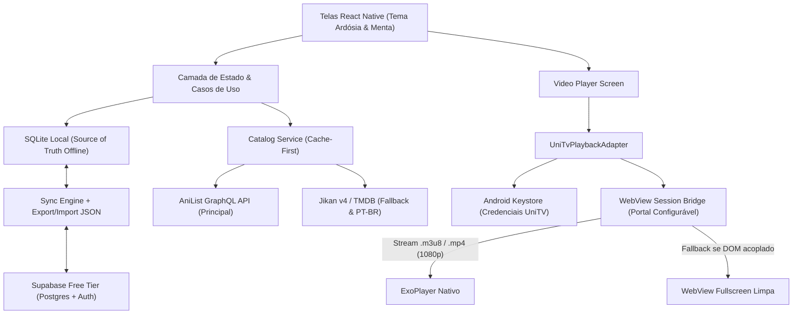

# Documento de Design — Personal Media Hub (V1: Animes)

**Data:** 2026-11-16  
**Plataforma alvo:** Mobile — Android prioritário (arquitetura preparada para futuro suporte iOS sem custo adicional na V1)  
**Público:** Uso estritamente pessoal (usuário único)  
**Orçamento adicional:** R$ 0,00 (restrição absoluta — única despesa existente mantida: assinatura anual UniTV)

---

## 1. Intenção e Motivação Pessoal (The Why)

O usuário não utiliza hoje nenhum serviço de controle (como MyAnimeList), assistindo animes diretamente no UniTV. A motivação do projeto nasce do desejo antigo de ter um espaço próprio que reúna **duas experiências no mesmo lugar**, sem a burocracia de uma planilha manual:

1. **Uma plataforma de streaming completa e autoral**, com página inicial de destaques, ranking dos mais assistidos do mês, lançamentos da temporada, catálogo amplo com filtros avançados, calendário semanal de episódios e radar de próximas temporadas — além de reprodução integrada em **máxima qualidade (Full HD / 1080p, sem marcas d'água)**.
2. **Um sistema de organização pessoal costurado dentro dessa plataforma**, em que status, progresso exato por episódio/minuto, ordem cronológica de temporadas, histórico e notas pessoais estejam presentes naturalmente em cada pôster, busca e player, preservados em nuvem sem custo.

---

## 2. Objetivos, Não-Objetivos e Anti-Objetivos

### Objetivos
- Entregar um aplicativo Android nativo (`.apk` instalável diretamente no aparelho, sem loja paga) com fluidez de plataforma de streaming.
- Oferecer **4 áreas principais**: Início Streaming, Catálogo & Explorar, Calendário & Próximas Temporadas, e Minha Biblioteca & Controle.
- Integrar os **6 status pessoais** em todo o app: `Assistindo`, `Pretendo assistir`, `Concluído`, `Pausado`, `Dropado` e `Reassistindo`.
- Reproduzir episódios do catálogo **dentro do próprio aplicativo** usando a conta anual existente do UniTV (login por usuário/e-mail e senha), priorizando o maior bitrate/resolução disponível (1080p Full HD, sem marcas d'água) e atualizando o progresso automaticamente.
- Garantir persistência **Local-First** (offline total para biblioteca/histórico) com sincronização em nuvem gratuita e exportação/importação de backup em arquivo `.json`.
- Manter arquitetura limpa e extensível para suportar `MOVIE` e `SERIES` futuramente sem implementar complexidade prematura na V1.

### Não-Objetivos (V1)
- Recursos sociais, perfis públicos, comentários de terceiros ou compartilhamento multiusuário.
- Publicação na Google Play Store ou Apple App Store na V1.
- Hospedagem, transcodificação ou armazenamento próprio de arquivos de vídeo.
- Implementação de interface ou catálogo ativo para filmes, séries ao vivo ou canais de TV na V1 (apenas estrutura de dados preparada para expansão).

### Anti-Objetivos (O que caracterizaria falha mesmo que tecnicamente funcional)
- Exigir preenchimento manual burocrático como condição para o app ser útil (parecer um clone de planilha ou do MyAnimeList).
- Ter identidade visual genérica ("vermelho Netflix", "azul padrão" ou aparência de site empacotado em navegador).
- Redirecionar o usuário para fora do app (para o aplicativo externo do UniTV) ao dar Play em um episódio.
- Exibir vídeos comprimidos em baixa resolução ou com marcas d'água quando a fonte original oferece qualidade limpa.
- Depender de qualquer serviço com cobrança recorrente, trial pago ou cartão de crédito obrigatório.

---

## 3. Restrição Absoluta de Custo Zero e Auditoria de Serviços

**Regra inegociável:** Nenhum componente, biblioteca, ferramenta de build, banco de dados ou API pode gerar custo financeiro adicional (> R$ 0,00) nem exigir cadastro de cartão de crédito.

| Serviço / Recurso | Preço & Condições | Limites Reais (Camada Gratuita) | Cadastro & Faturamento | Licença / Termos de Uso | Risco de Exceder Limite | Dependência Futura de Pagamento | Contingência / Migração Sem Custos |
| :--- | :--- | :--- | :--- | :--- | :--- | :--- | :--- |
| **AniList GraphQL API** *(Catálogo principal, Top do Mês, Temporadas, Calendário Semanal e Relações de Franquia)* | R$ 0,00 | **90 requisições/minuto** (HTTP 429 se exceder). | Sem cartão; API pública de leitura não exige conta paga. | Gratuita para uso **não comercial**. | **Baixo** para 1 usuário se houver cache local no SQLite + debounce na busca. | Risco baixo; API mantida para projetos pessoais/comunidade. | Cache local no SQLite mantém biblioteca e catálogo recente funcionais; **Jikan API v4** atua como fonte secundária imediata. |
| **Jikan API v4** *(Fallback de metadados e cruzamento de IDs MAL)* | R$ 0,00 | **3 req/segundo**, **60 req/minuto**, ilimitado por dia. | **Sem login, sem API key e sem cartão.** | Open source (**Licença MIT**); instância pública para uso leve/não comercial. | **Muito baixo** com fila/throttle simples e cache em SQLite. | Nenhuma; é possível inclusive rodar instância própria local se necessário. | Pode ser substituída pelo próprio AniList ou Kitsu API pública. |
| **TMDB API** *(Opcional na V1 para sinopses em PT-BR quando ausentes no AniList/Jikan)* | R$ 0,00 | Sem cota diária rígida divulgada; teto anti-abuso na faixa de **~40–50 req/segundo**. | Conta gratuita de desenvolvedor para gerar API key; **não exige cartão**. | Gratuita para uso **não comercial**; exige atribuição (logo/aviso no "Sobre" do app). | **Praticamente nulo** para 1 usuário buscando sob demanda com cache. | Não há plano pago self-serve para hobby; uso pessoal é coberto pelo tier gratuito. | App funciona normalmente sem TMDB exibindo sinopse em inglês/tradução local ou dados do AniList. |
| **Supabase Free Tier** *(Nuvem para sincronização e recuperação entre aparelhos)* | R$ 0,00 | **500 MB** de banco Postgres, **1 GB** storage, **5 GB/mês** egress, 2 projetos ativos. | **Não exige cartão de crédito.** | Uso gratuito contínuo dentro dos limites. | **Praticamente nulo** para biblioteca pessoal (~1–5 MB de texto/metadados). **Atenção:** projeto pausa após **7 dias sem atividade** (dados preservados por 1 ano, restauráveis no dashboard). | Nenhum upgrade necessário em uso pessoal; uso regular do app impede pausa automática. | App é **Local-First em SQLite** (nunca perde dados se nuvem pausar). Inclui exportação/importação de arquivo `.json` completo (local/Google Drive manual). |
| **Build & Instalação Android** *(Gradle local / Expo EAS Local ou GitHub Actions Free)* | R$ 0,00 | Compilação local ilimitada; GitHub Actions Free oferece **2.000 min/mês** Linux em repo privado (ilimitado em público) **sem cartão**. | Sem cartão; se atingir 2.000 min em repo privado, o workflow para sem cobrar. | Gratuita para uso pessoal. | **Muito baixo** (cada build Android gasta ~8–12 min). | Nenhuma. | Compilação 100% local via Android SDK/Gradle no Windows do usuário (`./gradlew assembleRelease`) + instalação direta via APK/ADB. |

---

## 4. Classificação de Evidências (Investigação Técnica)

### Requisitos Confirmados (Definidos pelo Usuário)
- Uso exclusivo pessoal (1 usuário), prioridade Android, instalação direta sem Play Store paga.
- Experiência visual completa de plataforma de streaming no tema **Ardósia Mineral & Menta Bioluminescente**, sem clones genéricos.
- Página do anime no modelo **Opção A (Tela Única Direta)**: cabeçalho, status, linha do tempo de temporadas/continuações e lista de episódios pronta para reproduzir ou marcar manualmente.
- Calendário semanal com dias de lançamento + página/radar de próximas temporadas com previsões de estreia.
- Reprodução integrada **dentro do app** via conta UniTV existente (login com usuário/e-mail e senha renovado via código de ativação), buscando **máxima qualidade disponível (1080p Full HD) e sem marcas d'água**.
- Flexibilidade prática no lançamento: entregar o produto completo e funcional primeiro, ajustando detalhes em atualizações futuras.

### Constatações Verificadas
- **Catálogos e APIs:** AniList GraphQL API fornece nativamente `airingSchedule` (dia/hora exata de lançamento semanal), `season`/`seasonYear` e `relations` (sequências, prequels, filmes, OVAs) e ranking por popularidade/tendência — cobrindo integralmente a tela inicial, catálogo, calendário e radar sem custo.
- **UniTV — Superfície APK Android:** O aplicativo oficial Android opera como APK fechado com bibliotecas nativas (`.so` via JNI) para handshake e vínculo de `device_id`. Emular o protocolo binário do APK traz alto risco de quebra em atualizações e conflito de sessão simultânea.
- **UniTV — Superfície Web Player (`uvwebs.info` e espelhos):** O serviço mantém acesso via navegador usando o **mesmo login (usuário/e-mail e senha)** da assinatura anual. No navegador, o catálogo VOD e a reprodução ocorrem via requisições web padrão (HTTP/JSON autenticadas pela sessão) e entrega de mídia HTML5 (`HLS .m3u8` / `MP4`). Planos de 1 tela bloqueiam reprodução simultânea em dois dispositivos ao mesmo tempo, mas permitem alternar normalmente entre aparelhos em momentos distintos.

### Hipóteses Técnicas (A Validar em Spike na Fase 1 de Execução)
- **H1 — Extração da stream limpa no Web Player:** Uma `WebView` autenticada na sessão do usuário conseguirá interceptar a requisição de mídia (`.m3u8` / `.mp4` + `Cookies`/`User-Agent`/`Referer`) gerada ao selecionar o episódio, permitindo repassar a URL ao player nativo (`ExoPlayer`) configurado para selecionar automaticamente a faixa de maior resolução (`1080p` / maior bitrate).
- **H2 — Casamento automático de títulos (AniList ↔ UniTV VOD):** A busca por título normalizado (romaji/inglês/português + número da temporada) no catálogo web do UniTV encontrará automaticamente o item correspondente na maioria dos casos, exigindo vínculo manual salvo em `unitv_links` apenas quando o nome divergir.

### Bloqueios e Limites Concretos
- **Domínio dinâmico do Web Player:** Portais web como `uvwebs.info` podem trocar de domínio periodicamente. **Mitigação obrigatória:** a URL base do portal não pode ser fixa em código — deve ficar editável nas Configurações do app (e opcionalmente atualizável via arquivo/configuração remota sem recompilar o APK).
- **Conteúdo protegido ou acoplado ao DOM web:** Se algum título no Web Player não expuser `.m3u8`/`.mp4` compatível com o `ExoPlayer` nativo (ex.: necessidade de contexto específico de scripts da página ou proteção de sessão), o app **não** tentará contornar DRM e acionará automaticamente o **Modo Fallback Integrado**: exibir o player HTML5 do próprio Web Player em tela cheia limpa (escondendo cabeçalhos/menus da página via CSS/JS injetado) dentro do aplicativo, preservando a experiência contínua sem sair do app.
- **Limite de telas da assinatura:** Se o usuário estiver assistindo simultaneamente em outro aparelho (TV Box) com conta de 1 tela, o servidor UniTV recusará/pausará a sessão; o app deve tratar essa resposta com mensagem clara para o usuário.

---

## 5. Abordagens Avaliadas e Decisão Arquitetural

| Critério | Abordagem 1 (ESCOLHIDA): React Native (Expo Prebuild) + SQLite + Supabase + WebView Bridge / ExoPlayer | Abordagem 2: Android Nativo (Kotlin / Jetpack Compose) + Google Drive API | Abordagem 3: Web App Empacotado (PWA / Capacitor) |
| :--- | :--- | :--- | :--- |
| **Qualidade da Experiência Mobile** | Nativa real (navegação nativa, gestos, player hardware ExoPlayer). | Excelente no Android. | Limitada (comportamento de página web, rolagem e player menos fluidos). |
| **Player Full HD + Ponte UniTV** | Controle completo: `react-native-webview` (autenticação/interceptação) + `react-native-video` (ExoPlayer com seleção de track 1080p). | Possível (WebView + Media3 ExoPlayer), mas exige mais código nativo manual. | Fraca: bloqueios de CORS, dificuldade para repassar headers customizados em HLS. |
| **Nuvem & Backup Grátis** | **Supabase Free** (sem expiração semanal de login, sem cartão) + SQLite Local-First + backup `.json`. | Google Drive API em app pessoal não publicado na Play Store fica em "modo teste" e **expira o login OAuth a cada 7 dias**. | Dependeria igualmente de backend externo. |
| **Futuro iOS / Expansão** | ~90–95% da base em TypeScript aproveitável se um dia compilar para iOS. | 0% reaproveitável para iOS. | Multiplataforma, mas com UX inferior. |
| **Custo Adicional** | **R$ 0,00** | **R$ 0,00** | **R$ 0,00** |

**Decisão:** Seguir com a **Abordagem 1**. Ela entrega interface e reprodução nativas de alto desempenho no Android, resolve o problema de expiração semanal do OAuth do Google Drive usando Supabase + SQLite Local-First, garante controle fino de qualidade de vídeo no ExoPlayer e mantém caminho aberto para iOS sem custo nem complexidade extra agora.

---

## 6. Design de Experiência, Telas e Identidade Visual

### Identidade Visual: "Ardósia Mineral & Menta Bioluminescente"
Visual autoral escuro, otimizado para telas AMOLED/OLED e conforto noturno, sem clichês de plataformas comerciais:

| Token | Hex | Aplicação |
| :--- | :--- | :--- |
| `bg.canvas` | `#080B0C` | Fundo principal das telas (ardósia quase preta) |
| `bg.surface` | `#0D1214` | Contêineres, bottom bar, cabeçalhos e modais |
| `bg.card` | `#131B1F` | Cards de anime, itens de lista e blocos de filtro |
| `border.subtle` | `#1E2C30` | Divisores finos e contornos de cartões |
| `accent.primary` | `#2DD4BF` | Menta bioluminescente — botão Play, barras de progresso, aba ativa, selos |
| `accent.secondary` | `#FB7185` | Coral suave — selos `#1 no Mês`, alertas de estreia e status `Dropado` |
| `accent.gold` | `#FBBF24` | Estrelas de avaliação pessoal e notas |
| `text.primary` | `#F0FDFA` | Títulos e texto principal |
| `text.secondary` | `#94A3B8` | Metadados, sinopse secundária e datas |

### Estrutura de Navegação (4 Abas Principais + Telas de Fluxo)

1. **Aba 1 — Início (Streaming)**
   - **Hero Destaque:** Banner interativo alternando entre o anime em andamento prioritário e o `#1 Em Alta no Mês`, com botão direto `▶ Continuar Ep. X` (ou `+ Adicionar à Lista`).
   - **Trilho "Continuar Assistindo":** Cartões com miniatura, episódio exato, minutos restantes e barra de progresso em menta.
   - **Trilho "🔥 Mais Assistidos no Mês":** Top 10 mensal numerado com badge discreto do seu status pessoal em cada capa (ex.: `Vendo`, `✓ Visto`, `+ Fila`).
   - **Trilho "Temporada Atual":** Animes em exibição no trimestre corrente.
   - **Trilho "Próximos Episódios da Semana":** Cartão resumido mostrando o que sai hoje/amanhã dos animes que você acompanha.

2. **Aba 2 — Catálogo & Explorar**
   - **Busca instantânea** por nome (português, inglês ou japonês/romaji).
   - **Filtros combináveis:** Gênero (multi-seleção), Ordenação (`Em Alta no Mês`, `Mais Populares`, `Melhor Avaliados`, `Lançamentos`), Ano/Temporada, Formato (`TV`, `Filme`, `OVA`) e **toggle "Ocultar já concluídos"**.
   - **Grade de Pôsteres:** Nota, ano e selo rápido de status no canto da capa (toque longo abre atalho de status sem precisar entrar na página).

3. **Aba 3 — Calendário & Lançamentos**
   - **Seletor superior duplo:** `Grade da Semana` | `Próximas Temporadas`.
   - **Grade da Semana (Em Lançamento):** Seletor de Segunda a Domingo destacando o dia atual; lista episódios que estreiam naquele dia com horário local, contagem regressiva e destaque visual em menta para títulos do seu `Assistindo` / `Pretendo assistir`.
   - **Radar de Próximas Temporadas:** Lista continuações e estreias futuras anunciadas com data/estação prevista (ex.: *Janeiro/2027* ou *Temporada de Primavera*), destacando com selo coral **"Nova temporada de algo que você viu!"** sempre que o título for sequência de algum item já presente na sua biblioteca.

4. **Aba 4 — Minha Biblioteca**
   - **Painel compacto de resumo** (total assistido, episódios vistos, em andamento) + **botão "🎲 Escolher por mim"** (sorteia um título dentro de `Pretendo assistir`, filtrável por gênero/duração, para dias de indecisão).
   - **Chips das 6 Categorias:** `Assistindo`, `Pretendo assistir`, `Concluído`, `Pausado`, `Dropado`, `Reassistindo`.
   - **Alternância Grade / Lista** + ordenação (Último assistido, Minha Nota, Progresso, Ordem Alfabética).

5. **Página de Detalhes do Anime (Opção A — Tela Única Direta)**
   - **Topo:** Capa, título, gêneros, nota pessoal editável (`0` a `10` em passos de `0.5`), seletor de status (`Assistindo`, `Pretendo...`) e indicador de vínculo UniTV (`Full HD ✓` ou `Vincular no UniTV`).
   - **Linha do Tempo da Franquia:** Chips navegáveis mostrando a ordem cronológica real da obra (`1ª Temp` → `OVA` → `2ª Temp` → `Filme`) com indicação do que já foi concluído.
   - **Sinopse expansível** (em 3 linhas por padrão, expande ao tocar) e campo discreto de **Anotações Pessoais**.
   - **Lista de Episódios Integrada:**
     - Episódio atual destacado com barra de progresso em minutos (ex.: `Ep. 06 · Parou em 09:40`).
     - Botão primário **`▶ Play`** (inicia reprodução interna no maior bitrate/1080p via UniTV) + botão secundário **`✓`** (marca/desmarca manualmente caso tenha visto na TV).
     - Ao concluir ou avançar manualmente até o último episódio de uma temporada, sugere com 1 toque mover para `Concluído` e ir para a continuação.

6. **Tela do Player Interno (Full HD)**
   - Modo paisagem imersivo, controles limpos sobre fundo translúcido (Play/Pause, avançar/voltar 10s, seletor de resolução indicando `1080p / Máxima`, velocidade, áudio/legenda se disponível na stream, botão `Próximo Episódio` nos últimos 90 segundos).
   - Salva o segundo exato a cada **10 segundos** e ao pausar/fechar. Ao cruzar **85% do episódio**, marca automaticamente como concluído e avança o cursor para o episódio seguinte.
   - Caso uma stream específica não possa ser extraída para o ExoPlayer nativo, comuta de forma transparente para a `WebView` limpa em tela cheia dentro da mesma tela do app, mantendo um pequeno botão flutuante para concluir/marcar o episódio.

7. **Configurações & Conta**
   - **Integração UniTV:** Login (usuário/e-mail e senha salvos criptografados no Android Keystore via `expo-secure-store`), **URL do Web Player configurável** (padrão inicial editável pelo usuário), botão "Testar Conexão & Sessão" e preferência de qualidade ("Sempre Máxima / Full HD").
   - **Dados & Continuidade:** Status da sincronização Supabase, botão "Sincronizar Agora", e **Exportar / Importar Backup `.json`** completo (para salvar no celular ou Google Drive manualmente).
   - **Preferências:** Tema/densidade, ocultar/exibir extras (como "Escolher por mim"), e créditos/atribuições de APIs gratuitas (AniList / Jikan / TMDB).

---

## 7. Arquitetura Técnica e Modelo de Dados

### Visão de Componentes

### Modelo de Dados (SQLite Local & Espelho Supabase)

Projetado para animes na V1, com campo discriminador `media_type` (`'ANIME'`, preparado para futuros `'MOVIE'` e `'SERIES'`) sem tabelas polimórficas complexas:

- **`media_items`**: `id` (UUID local), `media_type` (`'ANIME'`), `anilist_id`, `mal_id`, `tmdb_id`, `title_romaji`, `title_english`, `title_pt`, `synopsis`, `cover_url`, `banner_url`, `genres_json`, `season_year`, `season_name`, `episodes_total`, `status_airing`, `next_airing_at`, `next_airing_ep`, `relations_json`, `cached_at`.
- **`library_entries`**: `id`, `media_item_id`, `status` (`WATCHING | PLAN_TO_WATCH | COMPLETED | PAUSED | DROPPED | REWATCHING`), `personal_score` (real `0..10`), `current_episode` (int), `notes` (text), `rewatch_count` (int), `started_at`, `completed_at`, `updated_at`, `dirty` (flag de sync).
- **`episode_progress`**: `id`, `media_item_id`, `episode_number`, `position_seconds` (int), `duration_seconds` (int), `is_completed` (bool), `watched_via` (`APP_PLAYER | MANUAL`), `updated_at`, `dirty`.
- **`watch_history`**: `id`, `media_item_id`, `episode_number`, `action` (`STARTED | COMPLETED | STATUS_CHANGED`), `occurred_at`, `dirty`.
- **`unitv_links`**: `media_item_id`, `unitv_vod_id`, `unitv_title`, `unitv_season_tag`, `preferred_audio_or_sub`, `last_verified_at`. *(Guarda o vínculo confirmado para evitar buscas repetidas e permitir correção manual com 1 toque se o nome no UniTV for diferente).*
- **`app_settings`**: `unitv_portal_url`, `prefer_max_quality` (bool), `hide_completed_in_explore` (bool), `last_sync_at`. *(Credenciais UniTV ficam exclusivamente no `expo-secure-store`, nunca no SQLite/nuvem).*

### Fluxo do Conector UniTV (`UniTvPlaybackAdapter`)
1. Usuário toca em `▶ Play` no `Ep. 06` de *Solo Leveling (2ª Temp)*.
2. O app verifica em `unitv_links` se o título já possui mapeamento salvo. Se não, usa a sessão autenticada da `WebView` oculta para pesquisar os títulos candidatos (PT/EN/Romaji) no catálogo VOD do Web Player. Se houver ambiguidade (ex.: dublado vs. legendado ou 1ª vs. 2ª temp), exibe seletor rápido de vínculo na primeira vez e salva a escolha.
3. Ao selecionar o episódio `06`, o script injetado/interceptador da `WebView` captura a URL da stream (`.m3u8` / `.mp4`) e eventuais headers da sessão (`Cookie`, `Referer`, `User-Agent`).
4. O `ExoPlayer` nativo inicia a stream selecionando a faixa HLS de **maior resolução e bitrate disponíveis (1080p Full HD)** e retoma a partir de `episode_progress.position_seconds`.
5. Se nenhuma stream reproduzível diretamente pelo `ExoPlayer` for detectada dentro do timeout (ex.: 8s), o player muda automaticamente para o **Fallback Integrado** exibindo o vídeo da `WebView` em tela cheia com interface limpa (sem sair do aplicativo).

---

## 8. Separação de Escopo (V1 de Lançamento vs. Futuro)

| Funcionalidade | Entra na V1 (Lançamento Funcional) | Fica para Atualizações Futuras |
| :--- | :---: | :---: |
| Início Streaming (Hero, Continuar, Top do Mês, Temporada) | ✅ | |
| Catálogo completo com filtros combináveis + Ocultar concluídos | ✅ | |
| Calendário Semanal de episódios + Radar de Próximas Temporadas | ✅ | |
| Biblioteca pessoal com 6 status, Grade/Lista, notas e "Escolher por mim" | ✅ | |
| Detalhes Opção A (Linha cronológica da franquia + Episódios + Notas) | ✅ | |
| Player interno UniTV (ExoPlayer 1080p + Fallback WebView limpa) | ✅ | |
| Persistência SQLite Local-First + Sync Supabase Free + Backup `.json` | ✅ | |
| Notificações push/locais no celular quando sair episódio novo | | 🔜 V1.1 |
| Filmes e Séries (interface dedicada aproveitando `media_type`) | | 🔜 V2 |
| Suporte iOS / Build para iPhone | | 🔜 Futuro |
| Estatísticas detalhadas (gráficos de gêneros/horas assistidas) | | 🔜 V1.2 |

---

## 9. Escolhas do Agente (Builder Calls) & Pontos para Implementação

Para manter o processo ágil e objetivo, as seguintes decisões técnicas foram adotadas por conta do agente (*Builder Calls*) e revisadas no *Builder Check*, podendo ser ajustadas caso você prefira diferente:

- **Stack Mobile:** React Native com Expo Prebuild (`expo-dev-client` / build nativo local Gradle para gerar `.apk`) em TypeScript.
- **Player Nativo:** `react-native-video` (usando **Media3 ExoPlayer** no Android) com seleção automática da trilha de vídeo de maior resolução (`1080p` / maior bitrate) combinada com `react-native-webview` para a ponte de sessão do UniTV.
- **Abstração de Reprodução (`PlaybackSourceAdapter`) e Degradação Graciosa por Título:**
  - O player do aplicativo conversa com uma interface desacoplada (`PlaybackSourceAdapter`), tendo o `UniTvPlaybackAdapter` como provedor principal na V1. Isso permite adicionar ou trocar fontes de vídeo no futuro sem reescrever as telas do app.
  - Se um anime específico do catálogo AniList ainda não existir no VOD do UniTV (ex.: temporada futura, OVA raro ou atraso de catálogo), o anime funciona normalmente em toda a plataforma (busca, calendário, biblioteca e marcação manual `✓`), exibindo na lista de episódios o aviso `"Indisponível no UniTV · Vincular manualmente"` sem quebrar a experiência.
- **Pipeline de Busca e Títulos em Português (`pt-BR`) sem Bloquear o Setup:**
  - Como AniList e Jikan indexam primariamente títulos em Romaji, Inglês e sinônimos (`synonyms`), a busca principal na V1 funcionará imediatamente sem exigir cadastro de chaves extras, consultando AniList GraphQL + sinônimos do Jikan v4.
  - Caso o usuário insira uma chave gratuita da **TMDB API** nas Configurações (opcional, 0 custo e sem cartão), o app ativa automaticamente o enriquecimento em `pt-BR`: traduz a busca em português (ex.: *"Ataque dos Titãs"* → título original no AniList), exibe sinopses em português e usa o título localizado em `pt-BR` como candidato adicional no casamento automático com o catálogo do UniTV. Quando não houver chave TMDB configurada, caso um anime no UniTV esteja cadastrado apenas com nome traduzido em português, o usuário pode vinculá-lo manualmente 1 única vez na tela do anime (ficando salvo em `unitv_links` para todos os episódios).
- **Regra de Marcação Automática:** O progresso de tempo salva a cada 10 segundos no SQLite; ao atingir **85%** de um episódio, ele é marcado como concluído e atualiza o progresso geral do anime.
- **Autenticação na Nuvem Pessoal:** Como o app tem um único dono, o Supabase usará autenticação simples por e-mail/senha do próprio usuário (criada 1x na configuração) com Row-Level Security (RLS) restrita ao seu `user_id`, mantendo total privacidade mesmo no tier gratuito.

### Gate de Decisão na Fase 1 de Implementação (Spike Obrigatório do UniTV)
- A **Fase 1 do plano de implementação** será um **Spike prático de viabilidade do UniTV Web Player** (validando o domínio ativo atual, autenticação da sessão na `WebView`, busca no VOD e extração da stream `.m3u8`/`.mp4` em 1080p para o `ExoPlayer` vs. fallback em `WebView` fullscreen limpa).
- **Critério de Gate (Go / Pivot):**
  - Se o Spike confirmar a reprodução (via `ExoPlayer` ou fallback `WebView` limpa), seguimos diretamente para a construção completa do módulo de player e das telas.
  - Se o Spike revelar um bloqueio técnico total na conta do usuário (ex.: plano de código de ativação sem acesso ao Web Player, proteção anti-bot/CAPTCHA intransponível em `WebView` ou DRM incompatível), **pausamos imediatamente no fim da Fase 1** e apresentamos o diagnóstico ao usuário para decidir entre: (a) conectar uma fonte alternativa gratuita em Full HD através da mesma interface `PlaybackSourceAdapter`, ou (b) ajustar a estratégia de reprodução antes de construir o restante do player.
